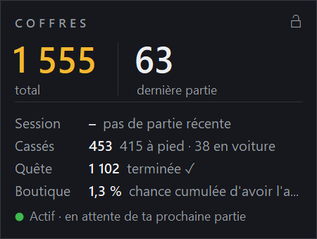

# Compteur de coffres Fortnite

Un petit programme Windows qui compte **les coffres que tu ouvres et que tu casses** dans Fortnite, partie après partie, en lisant les replays du jeu. Il affiche le résultat dans une petite fenêtre toujours visible et dans un tableau détaillé, et calcule tes **chances d'avoir obtenu les trésors** de la chasse au trésor de la saison (accès à la boutique pirate, tenue en or…).

La quête « Ouvrir des coffres » s'arrête à 1 000 : ce compteur continue.

## Fonctionnalités

- **Comptage automatique** environ une minute après chaque partie, sans rien faire.
- **Coffres ouverts**, y compris les coffres rechargés en cours de partie puis rouverts.
- **Coffres cassés** : à la pioche, en voiture, et les coffres qui tombent quand tu casses leur support (retrouvés grâce à leur butin).
- **Total d'escouade** (facultatif) : tes coffres + ceux de tes coéquipiers, amis ou randoms.
- **Tes chances** pour chaque trésor, avec les chances publiées par Epic et les **heures au trésor** où elles sont boostées.
- **Ta collection** : les trésors remis par un coffre doré, avec leur nom, et les « trésors sans nom » (le replay dit qu'un trésor a été remis, pas lequel). Une bulle près de l'horloge te prévient après la partie. Quand tu as eu l'accès à la boutique, coche « J'ai eu l'accès à la boutique » : le compteur affiche « obtenue ✓ » à la place de ta chance.
- **Petite fenêtre** toujours au premier plan, déplaçable, avec un voyant qui dit si tout marche.
- **Tableau détaillé** dans le navigateur (`http://localhost:8766`) : gros total, chance d'avoir eu l'accès à la boutique, bascule « Rien que toi / Avec tes coéquipiers », tuiles (par toi, coéquipiers, par partie, meilleure partie, par minute), graphique par partie ou par jour, détail par mode, par type de coffre et par partie. Il se recharge tout seul après chaque partie.
- **Replays d'un autre PC** : dépose des replays ou un dossier dans le tableau, ils sont comptés comme les autres.
- **Export et import** de toutes tes parties dans un fichier `.json`, pour les garder ou les reprendre sur un autre PC. Les exports du site [Fortnite Chest Counter](https://fortnite-chest-counter.vercel.app/) sont acceptés aussi.
- **Réglages dans le tableau** : coffres hors replays, valeur de ta quête, chance de la boutique, relecture de tous les replays.
- **Version OBS** de la petite fenêtre (`http://localhost:8766/overlay`, fond transparent).
- **Suivi de quête** : tu indiques ce que ta quête affiche, le compteur s'aligne dessus.
- **Coffres d'avant le compteur** : à ajouter à la main, ou à estimer depuis l'onglet Carrière.
- **Désinstallation** depuis le menu, en gardant ou non l'historique.

Seul le Battle Royale de la saison compte (avec ou sans construction). Le classé, OG, Reload, les modes temporaires et le Créatif sont affichés mais pas comptés.

## Installation (joueurs)

1. Dans Fortnite : **Réglages → Jeu → Replays**, active l'enregistrement des replays de Battle Royale.
2. Télécharge `CompteurCoffres.exe` dans la page **Releases** de ce dépôt et lance-le. Le programme n'est pas signé : si Windows affiche « Windows a protégé votre ordinateur », clique sur « Informations complémentaires » puis « Exécuter quand même ».
3. Clic droit sur le coffre près de l'horloge → coche **« Lancer au démarrage de Windows »**.

Au premier lancement, le programme lit tes anciens replays (quelques minutes, voyant orange). Pour voir la petite fenêtre par-dessus le jeu, mets Fortnite en « Plein écran fenêtré » ou « Fenêtré ».

Le fichier [`LISEZ-MOI.txt`](LISEZ-MOI.txt) détaille tout ça.

## Comment ça marche

Le programme lit uniquement les fichiers `.replay` que Fortnite enregistre dans `%LOCALAPPDATA%\FortniteGame\Saved\Demos`, une fois la partie finie, et ceux que tu déposes dans le tableau. Il ne touche pas au jeu, ne lit pas sa mémoire, ne se connecte à aucun compte et **n'envoie rien sur Internet**.

Le tableau est servi par le programme sur `localhost`, visible seulement sur ton PC. Ses boutons (ajout de replays, import, réglages) envoient leurs demandes avec un en-tête que les autres sites ne peuvent pas ajouter sans l'accord du programme, qui ne le donne jamais : une page web ouverte ailleurs ne peut rien y changer.

- Chaque coffre indique dans le replay qui l'a fouillé (`SearchingPawn`) : il compte comme ouvert quand c'est toi.
- Un `bAlreadySearched` remis à `false` signale un coffre rechargé : il peut être recompté.
- Quand un coffre est détruit, le serveur indique qui l'a cassé. S'il ne le dit pas (support cassé), le coffre est attribué au joueur le plus proche de son butin.
- Chaque replay est lu dans un processus séparé, avec une limite de 2 minutes : un replay qui fait boucler la bibliothèque de lecture ne bloque pas le compteur.
- La bibliothèque de lecture (FortniteReplayReader) est corrigée de l'extérieur pour deux défauts : les coffres posés sur la carte dont le nom d'instance n'est pas celui de leur classe (`Tiered_Chest_Athena47_UAID_…`), et les coffres reçus juste avant leur description.

**Précision** : c'est une estimation. Lors des tests, l'écart avec la quête du jeu était d'environ 1 %.

**Limites** :
- Seules les parties jouées sur ce PC, avec les replays activés, sont comptées.
- Un coffre ouvert par un coéquipier à plus de 150 m environ n'est pas dans ton replay.
- Hors coffre doré, le replay dit seulement qu'un trésor a été remis à ton escouade (`GA_TreasureHandler_Generic`, le même pour tous les trésors), sans dire lequel : l'accès à la boutique ne peut donc pas être reconnu tout seul.
- Une mise à jour de Fortnite peut casser la lecture : le voyant passe alors au rouge.

## Compiler

Il faut le [SDK .NET 10](https://dotnet.microsoft.com/download/dotnet/10.0) (Windows x64), puis lancer `build.bat`. Le programme est produit dans `dist\CompteurCoffres.exe` (un seul fichier, sans installation).

Note : le nom d'assemblage doit contenir `ReplayReader` (`CompteurCoffres.ReplayReader`), car la bibliothèque de lecture ne cherche les descriptions de coffres que dans les assemblages qui portent ce nom.

## Crédits

- La méthode de comptage (signature des coffres, coffres rechargés, coffres tombés, modes comptés), les chances et le calendrier des heures au trésor (`tresors.json`) viennent du projet libre [ChestCounter](https://github.com/LED-N/Fortnite-ChestCounter) de LED-N (licence MIT). Le code a été réécrit pour ce programme.
- Lecture des replays : [FortniteReplayReader](https://github.com/Shiqan/FortniteReplayDecompressor) de Shiqan (licence MIT), via NuGet.
- La présentation du tableau s'inspire du site [Fortnite Chest Counter](https://github.com/Jose-AE/fortnite-chest-counter) de Jose-AE. Aucun code n'en est repris (il est sous licence AGPL-3.0).

Voir [THIRD-PARTY-NOTICES.md](THIRD-PARTY-NOTICES.md).

Ce projet n'est ni affilié à Epic Games ni approuvé par Epic Games. Fortnite est une marque d'Epic Games, Inc.

## Licence

[MIT](LICENSE)
